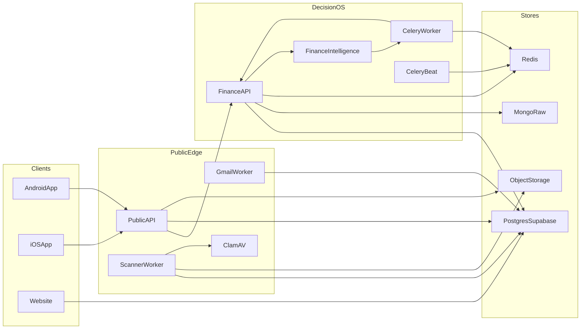
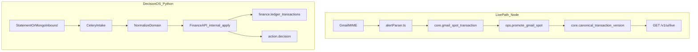
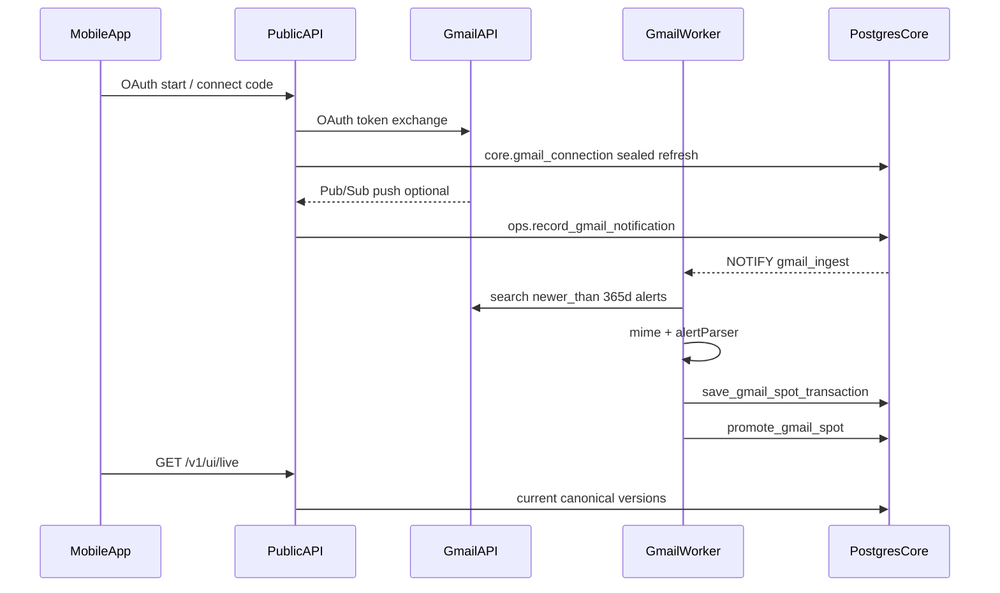
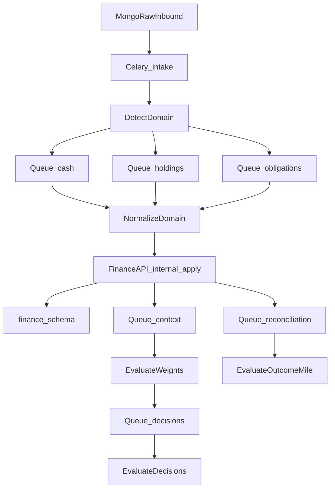

# Monytix Architecture

This document describes the complete Monytix system as implemented in this repository: clients, public edge, Decision OS, data stores, ingestion paths, and deployment topology.

**One-line summary:** Mobile clients talk only to the public API (`services/api`). Decision OS lives in `backend-monytix` and is reached through `FINANCE_BACKEND_URL`. Live ledger and Gmail spots are a Node/`core.*` path; statement intelligence and decisions are a Python/Celery/`finance.*` path.

---

## 1. System context



| Actor | Talks to | Does not talk to |
|---|---|---|
| Android / iOS | `PublicAPI` only (`:8080`) | `FinanceAPI`, intelligence, Postgres, Mongo |
| Marketing website | Postgres `marketing.*` (waitlist) | Product APIs (not in compose) |
| `PublicAPI` | Postgres `core`/`intel`/`ops`, object storage, optional proxy to `FinanceAPI` | Celery, Mongo (Gmail spots) |
| `FinanceAPI` | Postgres `finance`/`action`/`human_context`, Mongo, Redis, intelligence | Mobile directly |

---

## 2. Repository layout

| Path | Role |
|---|---|
| [`apps/android`](apps/android) | Kotlin Compose client (Live, Decisions, Missions, M.I.L.E.) |
| [`apps/ios`](apps/ios) | SwiftUI client (same product shell) |
| [`services/api`](services/api) | Public Fastify edge: Firebase auth, Live ledger, Node Gmail, local scanner fallback |
| [`backend-monytix/api`](backend-monytix/api) | Decision OS Fastify (`FinanceAPI`, `:8090`) |
| [`backend-monytix/intelligence`](backend-monytix/intelligence) | FastAPI + Celery (`FinanceIntelligence`, `:8091`) — never opens Postgres |
| [`website`](website) | Next.js marketing site (`:3001`); waitlist only |
| [`packages`](packages) | Shared contracts: OpenAPI, domain-event schemas, design tokens, fixtures |
| [`database`](database) | SQL migrations, bootstrap, seeds, verification |
| [`infrastructure`](infrastructure) | Dockerfiles, Dokploy, monitoring, backups |
| [`scripts`](scripts) | `migrate.sh`, `dev.ps1`, smoke helpers |

Root npm workspaces currently include only `services/api`. Decision OS packages have their own `package.json` / Python project files.

---

## 3. Runtime services

From [`docker-compose.yml`](docker-compose.yml) (Dokploy uses this file). Local ports and MinIO come from [`docker-compose.override.yml`](docker-compose.override.yml).

| Service | Process | Port | Responsibility |
|---|---|---|---|
| `migrator` | `scripts/migrate.sh` | — | Apply `database/migrations`, exit |
| `api` | `node dist/main.js` | `8080` | Public Fastify (`PublicAPI`) |
| `scanner` | `node dist/imports/scan-worker.js` | — | ClamAV + statement extract + retention (fallback path) |
| `gmail-worker` | `node dist/gmail/poll-worker.js` | — | Node Gmail poll → spot → promote |
| `clamav` | ClamAV | `3310` internal | Malware scan before extract |
| `redis` | Redis 7 AOF | `6379` | Celery broker + Decision OS caches/locks |
| `mongo` | Mongo 7 | `27017` | Raw ingest, Gmail creds (Decision OS), AA |
| `finance-api` | Fastify Decision OS | `8090` | Imports, UI decisions/missions, `finance.*` writes |
| `finance-intelligence` | FastAPI | `8091` | Normalize / extract / enqueue |
| `finance-celery-worker` | Celery | — | Domain queues (intake → decisions) |
| `finance-celery-beat` | Celery beat | — | Gmail renew, FX, forex, outcomes, snooze |
| `minio` | override only | `9000` | Local S3 |

**Postgres is external** (Supabase). It is not a compose service.

Health endpoints:

- Edge: `GET /platform/health`, `GET /platform/ready`
- Decision OS: `GET /health` on finance-api and finance-intelligence

---

## 4. Dual topology (do not collapse)

Monytix intentionally runs two parallel financial write models that share Firebase identity but **not** the same Gmail store or ledger rows.

| Concern | Node / D10 path | Decision OS path |
|---|---|---|
| Entry | `PublicAPI` + `GmailWorker` | `FinanceAPI` + Celery |
| Gmail credentials | `core.gmail_connection` | Mongo `gmail_credentials` |
| Live transaction alerts | `core.gmail_spot_transaction` → `ops.promote_gmail_spot` | Mongo inbound → normalize → `finance.ledger_transactions` |
| Statement extract | Local `ScannerWorker` (when proxy off) | FastAPI `/internal/extract-pdf` |
| Live UI reads | `core.canonical_transaction_version` via `/v1/ui/live` | Unused by Live |
| Decisions / missions | Proxied stubs → `FinanceAPI` | `action.*` + `human_context.*` |
| Account Aggregator | None | Mongo + Celery decrypt |



---

## 5. Data stores

### 5.1 Postgres (Supabase)

Roles: `monytix_api`, `monytix_intelligence`, `monytix_finance` (see `database/migrations/0003_m1_ops_roles.sql`, `0033_finance_normalized.sql`).

| Schema | Purpose |
|---|---|
| `core` | Identity, financial accounts, intake, **canonical ledger**, Gmail connection/spots, category rules |
| `intel` | Semantic resolutions (category, purpose, party, structure, entities) |
| `ops` | Migrations, outbox, idempotency; `SECURITY DEFINER` functions (`promote_gmail_spot`, `provision_authenticated_actor`, …) |
| `action` | Decisions, missions, outcomes, M.I.L.E. events |
| `ref` | Global registries (institutions, taxonomy, policies) |
| `spendsense` | Narration parser v4, `clean_counterparty_name` |
| `finance` | Decision OS write model (ledger, dues, MF, assets, debts, insurance, FX) |
| `human_context` | Weights, reflections, mode annotations |
| `marketing` | Website waitlist |
| `evidence` / `context` / `experience` | Reserved in foundation; no tables yet |

Canonical ledger view: `core.v_current_canonical_transaction`.

### 5.2 Mongo (`MONGO_DB=monytix_raw`)

Used by **FinanceAPI only**:

- `raw_inbound_records` — idempotent ingest (`PENDING` / `ROUTED` / `FAILED`)
- `gmail_credentials`, `gmail_push_messages` — Decision OS Gmail path
- `aa_consents`, `aa_sessions` — Account Aggregator

### 5.3 Redis

- Celery broker
- Home snapshot cache (`finance:home:{ownerId}`)
- Distributed locks for human/decision/outcomes/forex jobs

### 5.4 Object storage (S3-compatible)

Statement uploads (`OBJECT_STORAGE_*`). Local MinIO bucket `statements`. ClamAV required before extract.

---

## 6. API surfaces

### 6.1 PublicAPI (`services/api`)

Mounted in [`services/api/src/app.ts`](services/api/src/app.ts).

| Area | Routes | Backend |
|---|---|---|
| Auth | `GET /auth`, `POST /auth/logout` | Firebase Admin |
| Live | `GET /v1/live`, `GET /v1/ui/live` | `core` ledger |
| Ledger reads | `/v1/transactions`, `/v1/accounts/summaries`, `/v1/finance/overview` | `core` |
| Manual txn | `POST /v1/transactions/manual` | `core.logical_transaction` |
| Gmail | `/gmail/oauth/*`, `/v1/gmail/connect*`, `/gmail/webhook` | Node → Postgres |
| Platform | `/platform/health`, `/platform/ready` | Local |
| Proxied (when `FINANCE_BACKEND_URL` set) | `/v1/imports*`, `/v1/ui/decisions|missions|rewards|journey`, `/v1/decisions*`, `/v1/missions*`, `/v1/human-context*` | `FinanceAPI` |

Proxy behavior: [`services/api/src/plugins/financeProxy.ts`](services/api/src/plugins/financeProxy.ts) verifies Firebase, then forwards with `x-monytix-owner-id`.

**Not proxied today:** `/v1/aa/*`, `/v1/home`, `/v1/mile/*` (Decision OS–only or unregistered when proxy is on).

Partial OpenAPI: [`packages/api-contracts/openapi.yaml`](packages/api-contracts/openapi.yaml).

### 6.2 FinanceAPI (`backend-monytix/api`)

User (Firebase): imports, Gmail (Mongo path), AA consents/webhooks, `/v1/home`, UI decisions/missions/rewards/journey, domain list endpoints.

Internal (`Bearer INTERNAL_TOKEN`): `/v1/internal/apply`, ingest, FX, Gmail renew/checkpoint, human/decision/outcomes apply, route.

### 6.3 FinanceIntelligence (`backend-monytix/intelligence`)

All routes except `/health` require `INTERNAL_TOKEN`:

- `/internal/normalize`, `/internal/enqueue`, `/internal/extract-pdf`
- `/internal/evaluate-weights`, `/internal/evaluate-decisions`, `/internal/evaluate-outcome-mile`
- AA key material helpers

Celery **never** opens Postgres; it HTTP POSTs results back to FinanceAPI.

### 6.4 Website

Marketing pages + `POST /api/waitlist` → `marketing.waitlist_registration`. Not part of the compose product stack.

---

## 7. Authentication and trust boundaries

| Mechanism | Where | Purpose |
|---|---|---|
| Firebase ID tokens | PublicAPI + FinanceAPI | End-user session (`verifyIdToken`) |
| `ops.provision_authenticated_actor` / `ensure_personal_owner` | Both APIs | Map Firebase subject → `core.authenticated_actor` / `core.owner` |
| Google OIDC | Gmail Pub/Sub webhook only | Verify push authenticity |
| `INTERNAL_TOKEN` | FinanceAPI ↔ Intelligence ↔ Celery | Service-to-service |
| AA HMAC (`x-aa-signature`) | AA webhooks | Gateway authenticity |
| Sealed Gmail refresh tokens | `GMAIL_TOKEN_ENCRYPTION_KEY` | At-rest credential protection |

Public unauthenticated paths are limited to health, Gmail webhook/callback, and (on FinanceAPI) AA webhooks.

---

## 8. Ingestion paths

### 8.1 Live Gmail spots (production Live path)



Key code:

- Connect: [`services/api/src/gmail/connect.ts`](services/api/src/gmail/connect.ts)
- Poll: [`services/api/src/gmail/poll.ts`](services/api/src/gmail/poll.ts), [`poll-worker.ts`](services/api/src/gmail/poll-worker.ts)
- Parse: [`services/api/src/gmail/alertParser.ts`](services/api/src/gmail/alertParser.ts) (regex heuristics + boilerplate blacklist; not intelligence brand graph)
- Promote: `ops.promote_gmail_spot` (migrations `0032`, title cleanup `0042`)

### 8.2 Statement imports

**With proxy (compose/Dokploy default):**

1. Mobile → `POST /v1/imports` (proxied)
2. Presigned S3 PUT → complete
3. ClamAV → intelligence `/internal/extract-pdf`
4. Mongo `raw_inbound_records` → Celery `intake` → normalize → `finance.*`

**Without `FINANCE_BACKEND_URL`:** local [`services/api/src/imports`](services/api/src/imports) + `ScannerWorker` write `core.source_*` / extraction runs.

### 8.3 Account Aggregator

Consent + FI webhooks on FinanceAPI only ([`backend-monytix/api/src/aa.ts`](backend-monytix/api/src/aa.ts)). Encrypted FI payloads land in Mongo; Celery decrypts with `AA_FIU_PRIVATE_KEY`. Not on the public proxy; mobile does not call AA in the current shell.

---

## 9. Intelligence and Celery pipeline



Queues ([`intelligence/app/celery_app.py`](backend-monytix/intelligence/app/celery_app.py)): `intake`, `cash`, `holdings`, `obligations`, `reconciliation`, `context`, `decisions`.

Domain routing ([`tasks.py`](backend-monytix/intelligence/app/tasks.py)): ledger → cash; MF/investment/asset → holdings; due/debt/insurance → obligations.

Normalize ([`normalize/route.py`](backend-monytix/intelligence/app/normalize/route.py)): bank rows, rails, counterparties (`merchant.py` / `counterparty.py` brand maps), AA FI, forex/clearing.

Beat schedule (UTC): Gmail watch renew, ECB FX, forex reconcile, outcomes/M.I.L.E., snooze sweep.

**Important:** Live Gmail spots do **not** call `merchant.py`. Brand canonicalization on Live is limited to Node `alertParser` + SQL `spendsense.clean_counterparty_name` / keyword category list at promote time.

---

## 10. Ledger model

### 10.1 Canonical D10 (Live)

| Concept | Table | Notes |
|---|---|---|
| Stable identity | `core.logical_transaction` | Pointer `current_canonical_version_id` |
| Immutable version | `core.canonical_transaction_version` | New parse → new `version_no`; `is_current` flips via activate |
| Evidence | `core.transaction_evidence_link` | Links versions to source evidence |
| Gmail shadow | `core.gmail_spot_transaction` | Pre-promote alert row; all linked after promote |

Provenance values include `INITIAL`, `SYSTEM_REPROCESS`, `USER_CORRECTION`, `REVIEWER_CORRECTION`, `MIGRATION_CORRECTION`.

Reads for Live: current version + active identity + not superseded ([`services/api/src/ledger/read.ts`](services/api/src/ledger/read.ts)). Display titles cleaned in [`displayTitle.ts`](services/api/src/live/displayTitle.ts).

### 10.2 Decision OS finance ledger

`FinanceAPI` upserts `finance.ledger_transactions` (and related holdings/dues) keyed by Mongo source id + line number. Powers `/v1/home` and Decision OS UI — **not** `/v1/ui/live`.

---

## 11. Mobile product shell

Tabs: **Live**, **Decisions**, **Missions**, **M.I.L.E.**

| Screen | Client calls | Served by |
|---|---|---|
| Session | `/auth`, `/auth/logout` | PublicAPI |
| Live | `/v1/ui/live` | PublicAPI → `core` |
| Add statement | `/v1/imports*` | Proxied → FinanceAPI |
| Connect Gmail | `/gmail/oauth/start`, `/v1/gmail/connect/code` | PublicAPI Node (not proxied) |
| Decisions | `/v1/ui/decisions*` | Proxied → FinanceAPI |
| Missions | `/v1/ui/missions*` | Proxied → FinanceAPI |
| M.I.L.E. | `/v1/mile/*` | Not registered when finance proxy is enabled |

Live contract version: `ui-live-v0.1` ([`services/api/src/live/routes.ts`](services/api/src/live/routes.ts)). Decision/mission/mile availability flags on the edge Live payload are mostly `{ available: false }`; those domains load via their own proxied routes.

---

## 12. Deployment topology

```
Internet
  └─ PublicAPI :8080          (Dokploy public)
        ├─ Postgres (core / intel / ops)     Live + Node Gmail
        ├─ ObjectStorage + ClamAV
        ├─ GmailWorker / ScannerWorker
        └─ FinanceAPI :8090   (internal)
              ├─ MongoRaw
              ├─ Redis
              ├─ finance.* / action.* / human_context.*
              └─ FinanceIntelligence :8091 + Celery worker/beat

Website :3001 (separate deploy) → marketing.*
```

Local: [`scripts/dev.ps1`](scripts/dev.ps1) → compose + override (API `8080`, finance `8090`, intelligence `8091`, MinIO `9000`).

Production: Dokploy `-f docker-compose.yml` only; real S3 + Supabase + Firebase. See [`infrastructure/dokploy/README.md`](infrastructure/dokploy/README.md).

### Critical environment variables

| Group | Variables |
|---|---|
| Postgres | `DATABASE_URL`, `INTELLIGENCE_DATABASE_URL`, optional `FINANCE_DATABASE_URL`, `POSTGRES_*`, role passwords |
| Auth | `FIREBASE_PROJECT_ID`, `GOOGLE_APPLICATION_CREDENTIALS` or `GOOGLE_CREDENTIALS_JSON` |
| Storage | `OBJECT_STORAGE_*` |
| Decision OS | `INTERNAL_TOKEN`, `FINANCE_BACKEND_URL`, `INTELLIGENCE_URL`, `REDIS_URL`, `MONGO_URL`, `MONGO_DB` |
| Gmail | `GMAIL_CLIENT_ID/SECRET`, `GMAIL_REDIRECT_URI`, `GMAIL_TOKEN_ENCRYPTION_KEY`, Pub/Sub OIDC vars |
| AA (optional) | `AA_GATEWAY_URL`, client credentials, `AA_WEBHOOK_SECRET`, `AA_FIU_PRIVATE_KEY` |

Use session Postgres port `5432` (not pooler `:6543`) for migrations and workers that need session features.

---

## 13. Cross-cutting concerns

| Concern | Approach |
|---|---|
| Idempotency | `ops.idempotency_record`; Gmail spot keys (`ref:` / `hash:`); Mongo inbound unique keys |
| Outbox | `ops.outbox_event` for async fan-out |
| Secrets | Env + sealed Gmail tokens; never commit `.env` |
| Malware | ClamAV before PDF/XLS extract |
| Migrations | Ordered SQL under `database/migrations`; apply via `scripts/migrate.sh` |
| Observability | Structured JSON logs from workers; platform ready checks |

---

## 14. Design principles (as built)

1. **Mobile has one edge.** Apps never call Decision OS or databases directly.
2. **Live must be fast.** Gmail spot ingest stays on Node with regex extraction and Postgres promote — no Celery hop.
3. **Decision OS is rich and async.** Brand graphs, weights, decisions, and outcomes run in Python/Celery against `finance.*` / `action.*`.
4. **Identity is shared; ledgers are not.** Same Firebase subject → same `core.owner`; Live rows and Decision OS rows are different tables.
5. **Intelligence never owns persistence.** Normalize/evaluate return payloads; FinanceAPI applies them.

---

## 15. Related docs

| Doc | Contents |
|---|---|
| [`README.md`](README.md) | Quick start and local commands |
| [`infrastructure/dokploy/README.md`](infrastructure/dokploy/README.md) | Production compose / env |
| [`packages/api-contracts/openapi.yaml`](packages/api-contracts/openapi.yaml) | Partial HTTP contract |
| [`database/migrations/`](database/migrations) | Schema source of truth |

---

*Generated from the repository layout and runtime wiring. When behavior and this document disagree, trust the code and migrations, then update this file.*
